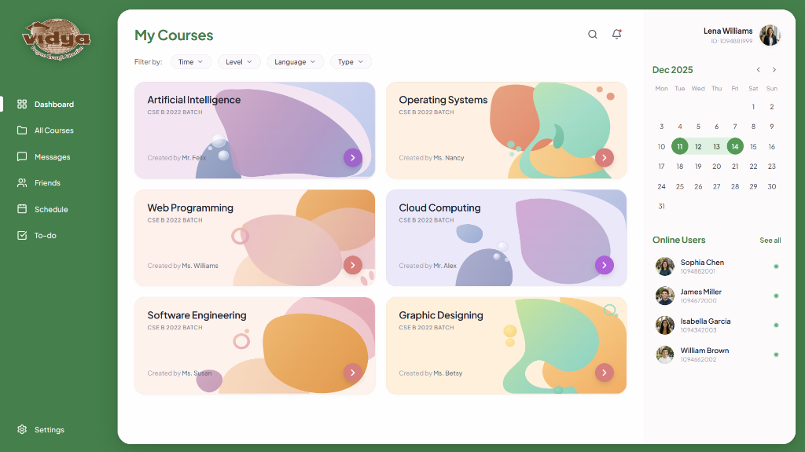

# Syamjith's Canvas2Code 🎨

Turning a visual reference into a working web experience.

Canvas2Code is a frontend recreation project built for the Canvas2Code challenge at VYVIDH '26. The goal is to translate a provided website design into a functional web interface using modern frontend technologies.

The project features a course dashboard inspired by virtual learning platforms, with a green sidebar, course cards, a calendar, and student information.

Here is the deployed link : https://syamdoes-canvas2code.vercel.app/



## ✨ Features

- **Course Dashboard** — A centralized view of six courses.
- **Illustrated Course Cards** — Individual visual themes for each subject.
- **Sidebar Navigation** — Quick access to dashboard sections.
- **Calendar Interface** — A visual overview of dates and scheduled activities.
- **Student Information** — Student profiles and related dashboard details.
- **Interactive UI** — A frontend designed to make navigating the dashboard intuitive.
- **Responsive Design** — Layout styling intended to support different screen sizes.

## 📚 Courses

The dashboard includes six subjects:

- Artificial Intelligence
- Operating Systems
- Web Programming
- Cloud Computing
- Software Engineering
- Graphic Designing

## 🛠️ Tech Stack

| Technology | Purpose |
| :--- | :--- |
| **React** | UI components and application structure |
| **Vite** | Development server and build tooling |
| **CSS** | Styling and layout |
| **Lucide React** | Interface icons |
| **JavaScript** | Application logic |

## 🚀 Getting Started

### Prerequisites

- [Node.js](https://nodejs.org/)
- npm

### Installation

Clone the repository:
```bash
git clone https://github.com/syamjithv/Canvas2Code.git
```

Navigate to the project directory:
```bash
cd Canvas2Code
```

Install dependencies:
```bash
npm install
```

Start the development server:
```bash
npm run dev
```

Open the local URL printed in your terminal to view the application.

### Production Build

Create a production build:
```bash
npm run build
```

## 📁 Project Structure

```text
Canvas2Code/
├── public/
│   └── images/
│       └── canvas2code-dashboard.png
├── src/
│   ├── assets/
│   ├── components/
│   ├── data/
│   ├── App.jsx
│   ├── App.css
│   └── index.css
├── index.html
├── package.json
└── vite.config.js
```

This is a simplified overview. Preserve the actual project structure and do not invent files.

## 🎯 Project Goal

This project explores the process of translating a visual design into a working frontend while balancing visual fidelity, component reuse, layout consistency, and functionality.

Built as a student project for VYVIDH '26.

## 👨‍💻 Author

Syamjith V  
GitHub: [@syamjithv](https://github.com/syamjithv)

Built with curiosity, code, and plenty of iterations. 💚
